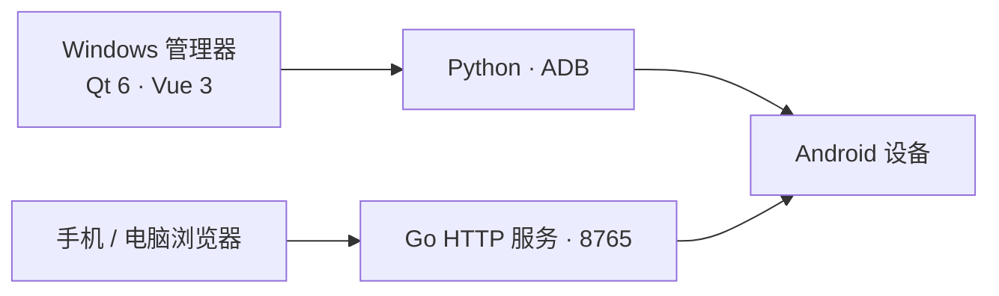

<div align="center">


# Android Web Desktop

**在浏览器中控制 Android，在 Windows 中轻松管理设备。**

适用于具有 ADB 调试能力的 Android 设备与随身 Wi-Fi，提供独立的局域网远程桌面和图形化设备管理器。

[](https://github.com/nljie1103/u30air-web-console/releases/latest)
[](https://github.com/nljie1103/u30air-web-console/actions)
[](https://github.com/nljie1103/u30air-web-console/releases/latest)
[](https://github.com/nljie1103/u30air-web-console/releases/latest)

**[下载便携版](https://github.com/nljie1103/u30air-web-console/releases/latest/download/AndroidWebDesktopManager-Portable.zip)** · **[下载独立 EXE](https://github.com/nljie1103/u30air-web-console/releases/latest/download/AndroidWebDesktopManager.exe)** · **[设备端安装包](https://github.com/nljie1103/u30air-web-console/releases/latest/download/android-web-desktop-arm64.zip)**

</div>

---

## ✨ 功能特性

<table>
<tr><td width="50%" valign="top">

**🖥️ Windows 设备管理器**

- Vue 3 / shadcn 风格，可折叠侧边栏
- USB、无线 ADB 与设备信息
- 一键安装官方 ADB 工具
- APK 下载、安装与应用管理
- 网页服务部署、升级和卸载

</td><td width="50%" valign="top">

**📱 Android 网页控制台**

- 浏览器远程屏幕、点击与滑动
- 应用列表、名称及可用图标
- APK 直链安装与本地上传
- CPU、内存、存储和运行时间
- 可选密码、在线更新与电源控制

</td></tr>
</table>

---

## 💻 系统要求

| 环境 | 要求 |
|:---|:---|
| Windows 管理器 | Windows 10 / 11 x64，发布包内含 Qt 运行库 |
| Android 设备端 | ARM64、已授权的 ADB Shell、设备上的私有局域网 IPv4 |
| 浏览器 | 能访问设备局域网地址的现代浏览器 |
| 网络 | 初次下载 ADB、在线更新及链接安装 APK 需要互联网 |

已在中兴 U30 Air（Android 13、ARM64）上验证过项目的基础远程桌面功能。其他型号须满足上述条件，具体权限与兼容性取决于系统固件；当前设备端未提供 32 位 ARM 或 x86 二进制。

> [!IMPORTANT]
> 本项目的 8765 控制台使用 HTTP，仅应在可信局域网使用，不应映射至公网。关闭访问密码后，所有能访问管理地址的用户都可控制设备；网页 APK 安装开关并不替代身份认证。首次部署需要正常授权 ADB，核心功能不主动请求 Root；部分电源、安装及系统操作仍可能受到固件权限限制。

---

## 📥 下载与快速开始

| 文件 | 用途 |
|:---|:---|
| [Windows 便携版 ZIP](https://github.com/nljie1103/u30air-web-console/releases/latest/download/AndroidWebDesktopManager-Portable.zip) | 推荐：完整解压后运行 EXE |
| [Windows 独立 EXE](https://github.com/nljie1103/u30air-web-console/releases/latest/download/AndroidWebDesktopManager.exe) | 单文件启动，运行时自行解包 |
| [Android ARM64 ZIP](https://github.com/nljie1103/u30air-web-console/releases/latest/download/android-web-desktop-arm64.zip) | 设备端服务与命令行部署脚本 |

1. 打开 Windows 管理器；如未发现 ADB，点击「一键安装 ADB」，自动下载 Google 官方工具，无需修改 PATH。
2. 连接设备并授权 USB 调试，或连接已启用 TCP ADB 的局域网设备。
3. 在「部署与更新」选择实际热点网关地址，选择是否启用网页密码，再安装最新版。
4. 安装完成后访问设备的 8765 端口，例如 [http://192.168.0.1:8765/](http://192.168.0.1:8765/)。

管理地址应以设备自身的局域网网卡为准，不能将移动网络动态 IP 当成固定热点网关。升级已部署服务时默认保留原有访问密码设置。

<details>
<summary><strong>Linux / macOS：使用命令行部署</strong></summary>

预先安装 ADB、连接并授权设备；使用支持脚本所需命令的 Bash（macOS 需 Bash 4+）。解压 Android ARM64 安装包后执行：

```bash
bash installer/install_linux_mac.sh
```

也可以在命令行指定设备序列号、局域网 IPv4 和端口。脚本为独立部署路径；Windows 管理器提供更完整的健康检查及恢复流程。

</details>

---

## 📦 应用安装器

无需维护应用商店目录，直接使用可信来源的 APK 下载地址或本地文件。

| 安装入口 | 下载网络 | 安装方式 |
|:---|:---|:---|
| Windows · 下载并安装 | 电脑网络 | ADB |
| Windows · 本地 APK | 无需下载 | ADB |
| 8765 · 设备下载并安装 | Android 设备网络 | Android 包管理器 |
| 8765 · 上传本地 APK | 浏览器已有文件 | Android 包管理器 |

Windows 中进入「应用管理 → APK 安装器」。网页端先启用「APK 安装器」中的独立开关，再输入 HTTPS 下载直链或上传文件。

> [!NOTE]
> 当前支持不超过 128 MiB 的普通单文件 APK。直链需使用 HTTPS（443 端口）；设备下载不允许访问私有及保留地址。如果设备不能访问 GitHub，请改用电脑下载或浏览器上传。APK 需与设备系统、架构及已安装应用签名匹配。不会自动卸载旧应用，也不直接支持 XAPK、APKS、APKM 或 GitHub Release 页面解析。

---

## 🎮 使用指南

### 远程桌面

页面提供自动刷新截图、点击、手势、全屏以及返回、主页、最近任务、唤醒和熄屏。独立 noVNC 为可选外部服务，不随本项目安装。

<details>
<summary><strong>中兴 U30 Air 桌面操作</strong></summary>

部分固件的 Launcher 没有桌面壁纸，只显示搜索框及短信快捷方式。黑色背景通常属于系统桌面的正常表现。先点击「主页」，然后从屏幕底部向上滑动（或点击「↑ 上滑」），即可尝试打开应用列表。

</details>

### 访问设置

首次安装可选择免密码，开启时允许自定义任意非空密码。后续可在 Windows「部署与更新」或网页「访问密码」中修改。密码变更会使旧网页登录会话失效。

网页端重启及关机需要确认。设备彻底关机后热点也会断开，不能依靠网页重新开机。

### 升级与卸载

通过 Windows「部署与更新」或 8765「检查更新」获取 GitHub 最新版。更新包使用 HTTPS 与 SHA256 校验；Windows 和网页的更新流程具有健康检查及恢复机制。

> [!WARNING]
> 卸载网页服务会删除本项目的设备端配置、密码、版本文件与日志，不会自动卸载其他 Android 应用。系统组件停用可能影响设备正常使用，操作前应核实用途。

---

## 🏗️ 技术架构



| 层级 | 技术 | 用途 |
|:---|:---|:---|
| Windows 窗口 | Qt 6 / PySide6 / Qt WebEngine | 内嵌前端，不依赖外部浏览器 |
| 桌面界面 | Vue 3 / TypeScript / Lucide | shadcn 风格交互组件 |
| 桌面后端 | Python / Qt WebChannel / ADB | 设备管理与部署 |
| Android 服务 | Go / ARM64 | HTTP 接口、截图、系统调用 |
| 网页界面 | HTML / CSS / JavaScript | 局域网远程控制 |

Windows 包内含 Chromium 渲染组件，体积大于纯 Qt Widgets。管理界面通过内部资源协议加载，不需要本机 HTTP 服务器。

### 项目结构

```text
.
├── .github/workflows/       # CI 与 Release
├── installer/              # Windows 客户端
│   ├── frontend/           # Vue 3 界面
│   ├── assets/             # 应用图标
│   ├── apk.py              # APK 下载与安装
│   ├── bridge.py           # 业务接口
│   └── tests/              # 客户端回归测试
├── web-console/            # Android 网页服务
│   ├── web/                # 控制台界面
│   ├── deploy/             # 安装脚本
│   ├── apk.go              # 设备端 APK 安装
│   └── version.json        # 发布版本及说明
├── .gitignore
└── README.md
```

---

## 💾 数据与配置

| 数据 | 位置与保留方式 |
|:---|:---|
| Windows 管理器配置 | 当前用户 LOCALAPPDATA 下 AndroidWebDesktop/manager-settings.json |
| Windows 官方 ADB | 同目录 platform-tools/ |
| Android 服务 | /data/local/tmp/android-web-desktop/ |
| Android 密码及安装开关 | 设备端服务目录下的 auth.json、password.txt、apk-install.enabled |
| 设备日志 | 设备端 server.log；Windows 运行日志保留在当前会话 |
| 下载与上传 APK | 临时文件，正常完成或失败后清理 |

备份设备端配置时应妥善保管密码文件；本项目没有外部数据库。

---

## 🛠️ 开发与构建

<details>
<summary><strong>Windows 客户端</strong></summary>

需要 Windows、Node.js 22 和 Python 3.12。使用 PowerShell：

```powershell
npm ci --prefix installer/frontend
npm run build --prefix installer/frontend
python -m pip install PySide6==6.11.3 pyinstaller==6.22.3
python -m unittest discover -s installer/tests -p "test_manager_*.py"
python installer/app.py --self-test
python -m PyInstaller --onedir --windowed --name AndroidWebDesktopManager --icon installer/assets/app.ico --add-data "installer/assets;assets" --add-data "installer/frontend/dist;frontend/dist" installer/app.py
```

</details>

<details>
<summary><strong>Android ARM64 服务</strong></summary>

需要 Go 1.23 或更新版本：

```bash
cd web-console
go test ./...
CGO_ENABLED=0 GOOS=linux GOARCH=arm64 go build -trimpath -o desktopd .
```

</details>

正式版本由 GitHub Actions 构建，并执行前端交互、Qt 窗口、ADB、Go 并发及版本一致性测试。查看 [构建记录](https://github.com/nljie1103/u30air-web-console/actions) 与 [更新记录](https://github.com/nljie1103/u30air-web-console/releases)。

---

## 📮 反馈与第三方声明

发现问题时请通过 [GitHub Issues](https://github.com/nljie1103/u30air-web-console/issues) 反馈，附上软件版本、设备型号与相关日志（请隐藏密码及敏感地址）。

第三方组件：[Windows 客户端](installer/THIRD_PARTY_NOTICES.md) · [Android 服务](web-console/THIRD_PARTY_NOTICES.md)

<div align="center">

**Android Web Desktop** · [项目主页](https://github.com/nljie1103/u30air-web-console)

</div>
