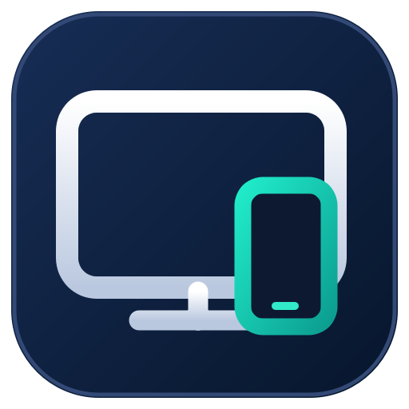

<div align="center">



# Android Web Desktop

**Qt 6 Windows 设备管理器 + Android ARM64 网页控制台**

在 Windows 上通过原生图形界面发现、安装和维护 Android 设备的网页远程控制服务。

[](https://github.com/nljie1103/u30air-web-console/releases/latest)
[](https://github.com/nljie1103/u30air-web-console/actions)
[](#安装)

**[下载 Windows 便携版（推荐）](https://github.com/nljie1103/u30air-web-console/releases/latest/download/AndroidWebDesktopManager-Portable.zip)** · **[下载独立 EXE](https://github.com/nljie1103/u30air-web-console/releases/latest/download/AndroidWebDesktopManager.exe)** · **[Android ARM64 安装包](https://github.com/nljie1103/u30air-web-console/releases/latest/download/android-web-desktop-arm64.zip)**

</div>

---

## 项目简介

本项目由两个相互独立的组件组成。

- **Windows 管理器**：采用 **Qt 6 / PySide6 的原生 Widgets** 编写，不使用 Edge、Chrome、WebView2，也不需要用户安装 Python 或 Qt。负责通过 ADB 搜索设备、查看信息、安装和更新网页服务、管理应用、修改网页登录设置及查看运行日志。
- **Android 网页控制台**：用 Go 编译为 Android ARM64 原生程序，在设备的局域网 IP 上提供 HTTP 服务（默认端口 **8765**）。支持浏览器查看和点击屏幕、上下左右滑动、应用管理、设备状态、唤醒/熄屏、重启/关机及自助在线更新。

Windows 管理器为当前唯一图形客户端打包目标；Android 设备端继续支持通过安装脚本从 Linux/macOS 使用 ADB 安装。Windows 管理器本身不是网页程序，但 **8765 远程控制台仍然需要浏览器访问**。

## 主要功能

| 组件 | 功能 |
|---|---|
| 原生 Windows 窗口 | Qt 6 卡片式界面、可折叠侧边栏、六个管理页面、软件图标 |
| 开箱即用 ADB | 自动检测本机 ADB；未找到时提供一键下载安装 Google 官方 Windows Platform-Tools |
| 设备管理 | USB / 无线 ADB 连接、品牌型号、Android 版本、CPU 架构、系统构建、监听地址 |
| 网关识别 | 优先热点/局域网接口，过滤常见蜂窝数据动态 IP，避免把服务绑定到不稳定的地址 |
| 安装维护 | GitHub 最新版下载与 SHA256 校验、本地 ZIP、一键安装/升级、失败恢复、卸载 |
| 应用管理 | 用户应用查看和卸载；非关键系统组件的停用/恢复及二次确认 |
| 网页桌面 | 截图实时刷新、点按与拖动滑动、四方向快捷手势、主页/返回/最近任务、唤醒/熄屏 |
| 设备资源 | CPU 占用、核心数、运行内存、设备存储空间、开机运行时长 |
| 网页密码 | 首次安装选择是否启用；可设置任意非空简单密码或关闭登录，支持后续客户端和网页修改 |
| 安全更新 | GitHub TLS 证书链验证、Release SHA256 校验、版本比对与失败恢复 |

### 两个不同的地址

| 用途 | 示例 |
|---|---|
| 中兴 U30 Air 官方管理后台 | http://192.168.0.1/ |
| UFI 插件（如已单独安装） | http://192.168.0.1:2333/ |
| 本项目 Android 网页桌面 | http://192.168.0.1:8765/ |

这几个服务端口不同，通常可以共存。**192.168.0.1 必须确实配置在设备的热点网卡上**，不能把蜂窝网络分配的动态 10.x 地址直接当成固定管理地址。对于其他 Android 设备，以管理器检测到的实际局域网 IP 为准。

---

## 安装

### Windows 10 / 11 · 无需手动配置运行环境

1. 下载 **AndroidWebDesktopManager-Portable.zip**，使用 7-Zip 或支持完整解压的工具解压全部文件，运行文件夹内的 `AndroidWebDesktopManager.exe`。也可以直接下载独立 EXE。
2. 首次启动如果没有找到 ADB，会自动询问是否**一键下载安装 Google 官方 ADB**。同意后自动安装到当前 Windows 用户的 AppData 目录，**无需管理员权限、修改 PATH 或安装开发环境**。
3. 用 USB 线连接 Android 设备，并在设备端授权 USB 调试；也支持输入设备 IP 和 ADB 端口连接无线 ADB。
4. 选择设备，打开「部署与更新」，确认推荐的热点网关地址，然后选择 **从 GitHub 安装最新版** 或本地 ZIP。
5. 在首次安装区域选择**不开启密码**，或勾选 **开启网页登录密码**并输入自己喜欢的密码（可只输入一个字符，无大小写/数字/符号要求）。启用密码时不能留空。
6. 安装完成后打开设备的 8765 地址，就可以通过手机或电脑浏览器查看远程桌面。

Google ADB 需要在首次下载时联网；**断网的首次安装无法自动获取 Google 工具**，但可以在设置页选取电脑已有的 `adb.exe`。ADB 安装程序来自 [Google 官方 Platform-Tools](https://developer.android.com/tools/releases/platform-tools)，本项目不将其打包成不明来源的可执行文件。

### 设置或关闭网页密码

首次安装可以自由选择是否开启登录。**关闭密码时，同一可信局域网内能连接管理地址的设备均可打开控制台并发送控制命令**，建议仅在受信任的随身 Wi-Fi 网络中使用。

后续可以在以下任意位置修改：

- Windows 管理器 → **部署与更新 → 修改现有网页访问密码**（通过已授权 ADB 保存并重启设备端服务）。
- 设备网页 → **访问密码**（已经开启登录的用户需先正常登录，保存后旧会话失效）。

已经安装的设备执行升级时，Windows 管理器默认**保留原有认证设置**，不会擅自清空密码。

### Linux / macOS · 命令行安装设备端

下载 Android ARM64 ZIP，安装本地 ADB 并连接设备，在解压目录运行：

```bash
bash installer/install_linux_mac.sh
```

多设备时可以指定 ADB 序列号及设备私有 IP：

```bash
bash installer/install_linux_mac.sh <ADB_SERIAL> <DEVICE_LAN_IP> 8765
```

安装脚本适用于已有 ADB 的终端，不提供 Qt 图形窗口。

---

## Android 网页端使用

### 远程屏幕与设备信息

用浏览器访问设备的 `http://局域网IP:8765/`。页面支持自动刷新屏幕画面，在图片中直接点击或滑动，也可使用「↑ 上滑 / ↓ 下滑 / ← 左滑 / → 右滑」快捷键，或进入全屏控制。

**设备状态**卡片位于「应用」与「设备信息」之间，展示 CPU、内存、设备存储及开机时长，每 5 秒刷新。资源数据来自 Android 的系统统计接口，不需要 Root。系统限制读取时显示「不可用」，不会编造数据。

**独立 noVNC 是可选组件，不随本项目安装。** 本项目的 8765 页面直接通过 Android 截图和输入命令运行，不需要 VNC/noVNC 或 WebSocket 代理。因此未部署独立 VNC 的设备不必访问 5800 端口。网页会检测是否真的存在 noVNC 客户端，再决定是否允许跳转。

### U30 Air 设备使用指南

中兴 U30 Air 的部分固件默认桌面**没有壁纸，看起来是黑色背景**，上面可能只显示搜索框和短信快捷图标。这通常是设备自带 Launcher 的界面表现，并不说明网页截图功能出错。

要查看应用列表，可以先点「主页」，然后在屏幕上**从下往上滑动**，或者点击网页中的 **↑ 上滑**。这属于 Android Launcher 常见的应用抽屉操作；不同固件的启动器细节可能不一样，不能仅据此断定它是未经定制的原版 AOSP 桌面。

### 重启、关机与唤醒

「唤醒」用于点亮已休眠的屏幕，不会自动解锁；「熄屏」仅关闭屏幕显示。重启和关机需要二次确认，且可能受到设备固件权限限制。**关机后热点也会断开，远程网页无法把完全关机的设备再开机**。

---

## 软件安全与限制

- 网页服务只允许绑定到设备明确配置的**私有局域网地址**，不应暴露到公网。
- 8765 默认使用 HTTP，并非加密 HTTPS。密码属于局域网便捷访问控制，**不建议用于不可信网络**。需要更严格隔离时，请使用可信网络、VPN 或其他访问控制，而不是将端口做公网映射。
- 设备端在线检查更新使用有效的受信任 TLS 根证书，并验证 GitHub Release SHA256。对于精简 Android 系统可能出现的 `x509: certificate signed by unknown authority`，程序补充了受信任的 Mozilla CA 集合，**不会关闭证书校验**。
- Windows 下载 Google ADB 和 Android Release 均需要互联网。未授权 USB 调试的设备无法通过客户端绕过 Android 授权。
- 无法禁用系统关键组件、无法获得缺失的 Android 系统权限。停用系统组件前请先了解该组件作用。
- U30 Air 的画面通过定时截图实现，**不是高帧率视频推流**。

---

## 项目目录

```text
android-web-desktop/
├── .github/workflows/release.yml    # 仅 Windows Qt GUI + Android ARM64 的 CI/Release
├── installer/                     # Windows Qt6 原生客户端源码
│   ├── app.py                     # Qt 启动入口
│   ├── qt_window.py               # 原生控件、六页面与异步 ADB 任务
│   ├── version.py                 # 唯一 Windows 客户端版本常量
│   ├── bridge.py                  # 设备管理业务逻辑
│   ├── adb_client.py              # USB/无线 ADB 操作
│   ├── deployment.py              # 下载、认证选项、安装与恢复
│   ├── assets/                    # APP PNG / ICO / SVG 图标
│   └── tests/                     # Windows Qt 与 ADB 回归测试
├── web-console/                   # Android 设备端 Go + 浏览器页面
│   ├── main.go                    # REST/HTTP 与系统控制
│   ├── auth.go                    # 密码开关、认证与会话
│   ├── metrics.go                 # CPU/内存/存储系统状态
│   ├── update.go                  # 在线更新与恢复
│   ├── trust.go                   # GitHub HTTPS 受信任 CA
│   ├── web/                       # 手机/电脑访问的 HTML/CSS/JS
│   ├── tests/                     # 浏览器端交互测试
│   ├── deploy/                    # 设备端安装脚本
│   ├── version.json               # 官方 Release 版本与说明
│   └── go.mod
├── .gitignore
└── README.md
```

仓库根目录只包含上述五类项目文件，不再保留旧 Edge/Vue Windows 管理器。Android 网页端依旧使用 HTML/JavaScript，这是远程浏览器界面，并非 Windows 客户端实现。

### 从源码构建 Windows 客户端

在 Windows 10/11 x64 环境中，使用 Python 3.12：

```powershell
python -m pip install PySide6==6.11.3 pyinstaller==6.22.3
python -m unittest discover -s installer/tests -p "test_manager_*.py"
python installer/app.py --self-test
python -m PyInstaller --onedir --windowed --name AndroidWebDesktopManager --icon installer/assets/app.ico --add-data "installer/assets;assets" installer/app.py
```

发布流程在 GitHub Actions Windows runner 上分别构建便携版和独立 EXE，并执行原生 Qt 窗口显示、移动、页面切换及 Python/ADB 测试。当前**仅分发 Windows 客户端**，不制作 macOS/Linux GUI 软件包。Qt for Python 开源版使用 LGPLv3/GPLv3 等适用许可，见 [第三方声明](installer/THIRD_PARTY_NOTICES.md)。

### 从源码构建 Android ARM64 设备端

```bash
cd web-console
go test ./...
CGO_ENABLED=0 GOOS=linux GOARCH=arm64 go build -trimpath -o desktopd .
```

---

## 帮助和反馈

遇到无法识别设备时，检查 ADB 是否已安装、USB 调试是否授权、连接是否稳定及推荐 IP 是否属于热点网卡。更新失败时检查 GitHub 网络连通性、系统时间和证书错误提示。

欢迎通过 [GitHub Issues](https://github.com/nljie1103/u30air-web-console/issues) 反馈问题。

<div align="center">

**[项目仓库](https://github.com/nljie1103/u30air-web-console)** · **[最新版本](https://github.com/nljie1103/u30air-web-console/releases/latest)**

</div>
